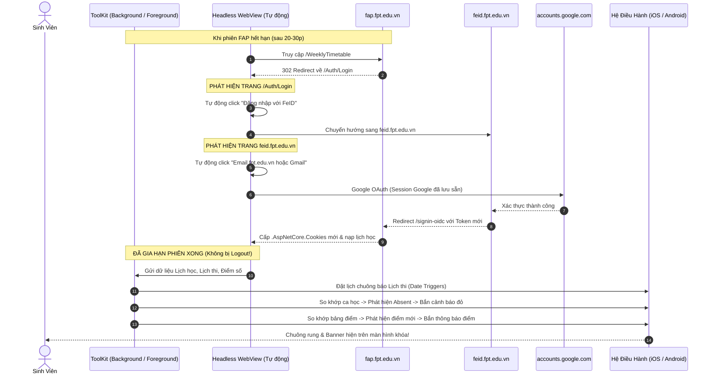

# Kế Hoạch Tối Ưu Hóa: Tự Động Lấy Dữ Liệu FAP & Thông Báo Không Cần Vào App

## Goal Description
Người dùng xác nhận chính xác quy trình đăng nhập thực tế của sinh viên Đại học FPT:
> **Bắt buộc bấm "Đăng nhập với FeID" trên FAP trước, sau đó tại trang FeID mới bấm "Email fpt.edu.vn hoặc Gmail" (Google SSO) để chọn tài khoản.**

Kế hoạch này giải quyết dứt điểm 4 bài toán:
1. **Thông báo nhắc nhở khi bị đánh Absent trong ngày hôm nay** (ngay sau ca học +10p).
2. **Thông báo nhắc nhở sắp đến lịch kiểm tra / thi** (chạy độc lập ở cấp hệ điều hành, tắt app vẫn đổ chuông đúng giờ).
3. **Thông báo khi điểm các môn học được cập nhật mới**.
4. **Chấm dứt hoàn toàn tình trạng tự động Logout**: Tự động vượt qua chuỗi redirect `FAP -> FeID -> Google SSO` trong chế độ ngầm để gia hạn phiên FAP mà người dùng không cần phải bấm lại bằng tay.



---

## User Review Required

> [!IMPORTANT]
> **Điểm cải tiến mang tính bước ngoặt so với code cũ:**
> 1. **Tại sao trước đây cứ một thời gian là bị logout?**
>    Trong file `FapSilentAutoChecker.js` cũ (dòng 127):
>    ```javascript
>    if (url.includes('/auth/login') || url.includes('feid.fpt.edu.vn') || url.includes('accounts.google.com')) {
>      onError?.('Phiên đăng nhập FAP đã hết hạn. Vui lòng mở lại FAP để đăng nhập.');
>    }
>    ```
>    Code cũ ngay khi thấy URL bị chuyển hướng về login thì **lập tức ném lỗi báo phiên hết hạn và đóng tiến trình**. Trong khi đó, session Google của sinh viên vẫn còn lưu trong WebView!
>    👉 **Cách sửa mới**: Thay vì ném lỗi, app sẽ tự động click nút **"Đăng nhập với FeID"** -> chuyển sang FeID tự click **"Email fpt.edu.vn hoặc Gmail"** -> Google tự động phê duyệt -> FAP gia hạn cookie -> Hoàn thành cào lịch mà sinh viên **không hề hay biết và không bao giờ bị logout**.
>
> 2. **Tại sao trước đây đóng app là không có chuông báo thi?**
>    Code cũ trong `fapExamHelper.js` dùng `trigger: null` chạy trong một hàm `setInterval` của React Native. Khi sinh viên tắt app, React unmount và `setInterval` bị hủy -> Không thể báo thi khi đóng app.
>    👉 **Cách sửa mới**: Dùng **OS Date Triggers** của hệ điều hành `expo-notifications`: Đặt lịch trước 19h00 tối hôm trước và trước giờ thi 60 phút. Hệ điều hành iOS/Android tự quản lý và đổ chuông độc lập.

---

## Proposed Changes

### Component 1: Tự Động Hóa Chuỗi Đăng Nhập `FAP -> FeID -> Google SSO`

#### [MODIFY] `src/features/fap/FapSilentAutoChecker.js`
- Xóa bỏ logic ngắt ngang ném lỗi khi gặp URL `/auth/login` hoặc `feid.fpt.edu.vn`.
- Tích hợp kịch bản **Smart Auto-Chain Authenticator**:
  1. Khi URL chứa `/auth/login`:
     - Tự động tìm và click phần tử có chữ `Đăng nhập với FeID` hoặc `value="FeID"`.
  2. Khi URL chứa `feid.fpt.edu.vn`:
     - Tự động tìm và click phần tử `Email fpt.edu.vn hoặc Gmail` (nút SSO Google).
  3. Khi URL chứa `accounts.google.com`:
     - Nếu Google hiển thị danh sách tài khoản đã đăng nhập trước đó (ví dụ `ndhung.work@gmail.com`), tự động chọn tài khoản đầu tiên.
  4. Khi URL quay về `fap.fpt.edu.vn/WeeklyTimetable` hoặc `/ExamSchedule`:
     - Bắt đầu cào dữ liệu và gửi thông báo thành công.

#### [MODIFY] `src/features/fap/FapRealWebViewModal.js`
- Tối ưu hóa WebView lưu trữ cookie bền vững (`sharedCookiesEnabled={true}`, `thirdPartyCookiesEnabled={true}`, `domStorageEnabled={true}`).
- Giúp người dùng khi mở lại modal cũng được tự động điền / tự động click nếu phiên vừa hết hạn.

---

### Component 2: Báo Thi Bằng OS Native Scheduled Triggers (`fapExamHelper.js`)

#### [MODIFY] `src/features/fap/fapExamHelper.js`
- Viết mới hàm `scheduleAllExamRemindersNative(exams, defaultReminderMins)`:
  - Quét tất cả các môn thi trong tương lai từ danh sách `exams`.
  - Parse chính xác ngày thi `dd/MM/yyyy` và giờ thi `HHhMM-HHhMM`.
  - Lên lịch 2 thông báo chuẩn cho mỗi môn thi:
    - **Mốc 1**: 19h00 tối hôm trước ngày thi (`targetDay - 1` lúc 19:00).
      - Tiêu đề: `🔔 Lịch thi ngày mai: [Mã môn] lúc [Giờ thi]`
      - Nội dung: `Ngày mai bạn có lịch thi môn [Tên môn] tại phòng [Phòng thi]. Chúc bạn ôn tập tốt!`
    - **Mốc 2**: Trước giờ thi `defaultReminderMins` phút (mặc định 60 phút):
      - Tiêu đề: `⏳ Sắp đến giờ thi: [Mã môn] tại phòng [Phòng thi]`
      - Nội dung: `Ca thi bắt đầu lúc [Giờ thi]. Đừng quên mang theo thẻ sinh viên và dụng cụ làm bài!`
  - Đăng ký qua `Notifications.scheduleNotificationAsync({ content, trigger: { type: 'date', date: notifyDate } })`.
  - Hủy các lịch nhắc thi cũ trước khi tạo lịch mới để không bị trùng thông báo.

---

### Component 3: Cảnh Báo Vắng (Absent) Trong Ngày & Cập Nhật Điểm Mới

#### [MODIFY] `src/features/fap/fapNotificationHelper.js`
- Cải tiến `scheduleAttendanceSlotReminders(slots)`:
  - Đặt lịch hẹn giờ hệ thống đúng `Giờ kết thúc ca + 10 phút` cho mọi ca học trong ngày.
  - Khi đến giờ, hệ điều hành đánh thức máy và thông báo nhắc nhở kiểm tra điểm danh.
- Viết mới hàm `detectAndAlertAbsentSlots(newSlots, savedSlots)`:
  - So sánh chi tiết từng ca học hôm nay.
  - Nếu phát hiện ca học chuyển sang trạng thái `Absent` hoặc `Vắng`:
    - Bắn ngay thông báo khẩn cấp `AndroidNotificationPriority.MAX` kèm âm thanh và rung báo động.

#### [MODIFY] `src/features/fap/fapGradeHelper.js`
- Bổ sung hàm `detectAndAlertGradeUpdates(newGrades, oldGrades)`:
  - So sánh cấu trúc điểm chi tiết của từng môn học (Lab, Assignment, Progress Test, Final).
  - Nếu phát hiện môn có điểm mới xuất hiện:
    - Bắn thông báo: `🎉 Điểm FAP mới: Môn [Mã môn] vừa cập nhật điểm [Tên đầu điểm]: [Số điểm]!`

#### [MODIFY] `src/features/fap/FapExamScreen.js`
- Tích hợp tự động kích hoạt `scheduleAllExamRemindersNative` ngay khi đồng bộ lịch thi thành công.
- Tự động kích hoạt kiểm tra Absent và kiểm tra Điểm mới sau mỗi lần sync ngầm.

---

## Verification Plan

### Automated Tests & Lint
```bash
npx eslint src/features/fap/
npm run lint
```

### Manual Verification Flow
1. **Kiểm tra Auto-Relogin (FAP -> FeID -> Google SSO)**:
   - Mở màn hình FAP, kích hoạt kiểm tra ngầm.
   - Quan sát WebView tự click "Đăng nhập với FeID" -> chuyển sang FeID tự click "Email fpt.edu.vn hoặc Gmail" -> hoàn tất đăng nhập mà không văng ra báo lỗi.
2. **Kiểm tra Lịch thi khi đóng app hoàn toàn**:
   - Thêm 1 môn thi có giờ thi sau 2 phút.
   - Vuốt tắt hoàn toàn app ToolKit.
   - Chờ đúng giờ -> Xác nhận điện thoại phát chuông thông báo và hiện banner trên màn hình khóa.
3. **Kiểm tra Cảnh báo Absent & Điểm mới**:
   - Giả lập ca học có status `Absent` -> Kiểm tra thông báo cảnh báo đỏ xuất hiện tức thì.
   - Giả lập bảng điểm có đầu điểm mới -> Kiểm tra thông báo điểm mới hiển thị đúng tên môn và số điểm.
